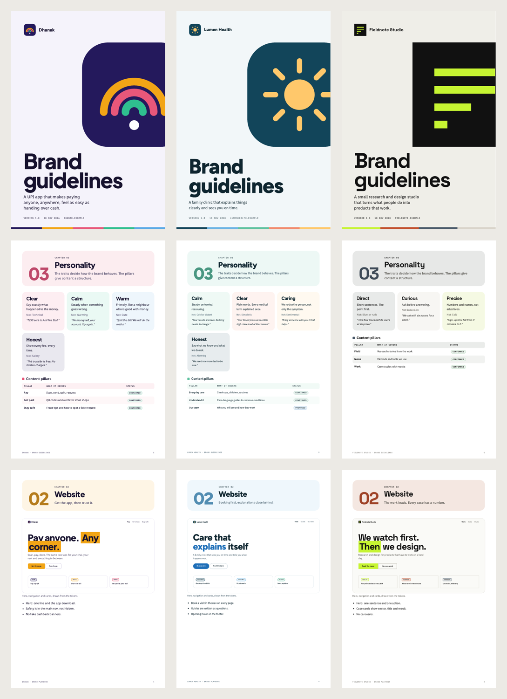

# Design System Toolkit

Your logo in, your design system out.

A free plugin for Claude Code that turns your logo and brand notes into a full design system: brand guidelines, a playbook, working components, slides, a one-page summary, a first-day page, and a brief any AI can follow to make on-brand work.

You answer a few questions. The AI writes two small files. Fixed templates do the design, so the result looks finished, and every page checks its own text is readable.



## See it first

Three made-up brands come with the plugin. Their finished guidelines are in [`samples/`](samples/):

| Sample | What it is | Look |
|---|---|---|
| Dhanak | A UPI payment app | Deep indigo and marigold, app-like corners, Indian-language-ready fonts |
| Lumen Health | A family clinic | Soft and round, deep teal and calm blue |
| Fieldnote Studio | A research and design studio | Square, black and lime |

## Install (Claude Code)

From a terminal, in one step (Claude Code 2.1.275 or later):

```
claude plugin install ds-toolkit --marketplace pradeepsiddappa/design-system-toolkit
```

Or inside Claude Code:

```
/plugin marketplace add pradeepsiddappa/design-system-toolkit
/plugin install ds-toolkit@designers-who-build
```

Then type `/ds-toolkit:setup`. To build a sample instead, type `/ds-toolkit:setup sample dhanak` (or `lumen-health`, `fieldnote-studio`).

You need Node 18 or later (Claude Code already does). Google Chrome is used to save PDFs if you have it. Without it, open any page and use Print, then Save as PDF.

## What the wizard asks

1. **What to make.** Pick any of: guidelines and playbook, the component sheet, the quick set (one page, slides, onboarding), the AI files. The foundations are always included.
2. **Your logo.** Any format. A vector file (SVG, PDF, AI, EPS) is best. You confirm you own it.
3. **Your brand material.** A brand PDF, a deck, website text, notes, or nothing at all.
4. **Confirm.** It shows the colours, fonts and voice it found, each tagged with where it came from. You accept or change them, and rewrite three sample lines in your own words.
5. **Build.** It checks everything, then makes the folder.

Add something later with `/ds-toolkit:setup add slides`.

## What you get

```
my-design-system/
  START-HERE.md
  foundations/   tokens.css, tokens.json, brand.js, your logo
  guidelines/    guidelines and playbook, as web pages and PDFs
  components/    components.css and a live component sheet
  quick/         one-page summary, six slides, onboarding page
  ai/            agent-brief.md and voice.md, for any AI making an asset
  checks/        CHECKLIST.md
```

- **Components** come styled in your brand: buttons, fields, dropdowns, checkboxes, switches, tags, cards, notes, navigation, tabs, tables, avatars, toasts and dialogs.
- **One source.** Every page reads `tokens.css` (the values) and `brand.js` (the words). Change a colour once and everything follows.
- **Readable by rule.** Every piece of text must reach 4.5:1 contrast on what is behind it (3:1 for large text). The pages fix coloured words that fall short, and say so.
- **Honest.** Values the AI was unsure about are tagged "To confirm", "Assumption" or "Proposed" until you approve them. Nothing about your business is invented: gaps are listed instead.

## Where AI is used, and where it is not

| Who | Does what |
|---|---|
| **The AI** (Claude, or the AI you use) | Reads your logo and notes. Drafts the colours, fonts, voice and rules into two small files, tagging each value with where it came from. Proposes fixes when something fails a check |
| **The toolkit** (no AI) | Fixed templates lay out every page, the same way every time. Scripts check the files, contrast and copy, and print the PDFs |
| **You** | Confirm you own the logo. Accept or change every value. Rewrite three lines in your own words. Decide anything still marked "To confirm" |

The AI drafts. The toolkit builds and checks. You decide.

## After set-up: just ask

Once your design system exists, ask for anything on brand with the second command:

```
/ds-toolkit:make an Instagram post about our new split-the-bill feature
/ds-toolkit:make a YouTube thumbnail for "How to spot a fake payment request"
/ds-toolkit:make an A4 poster for a shop counter with a space for the QR code
```

See eight it made for the Dhanak sample in [`samples/made-with-make/`](samples/made-with-make/).

It reads your brief, voice and tokens, makes the asset as an HTML file in `assets/`, checks readability, colours and words, and saves a PNG. Formats it knows: square, portrait and story posts, LinkedIn posts and banners, YouTube thumbnails, slides, emails, web page sections, app screens, posters and business cards.

## Use it for

| Job | What to do |
|---|---|
| Start a brand from a logo | `/ds-toolkit:setup` |
| Only need slides for a pitch | Pick the quick set in step 1 |
| Make a social post on brand | "Read ai/agent-brief.md and make an Instagram post about splitting the bill" |
| Hand off to a developer | Give them `foundations/tokens.css` and `components/components.css` |
| Change a brand colour | Edit one line in `tokens.css`, then reopen the pages |
| Welcome a new teammate | Send them `quick/onboarding.html` |
| Do it for clients | One folder per client, same steps |

## Other AIs (Claude app, ChatGPT, Gemini)

The quickest way: copy [`PROMPT.md`](PROMPT.md) into a new chat. It runs the same wizard and gives you the two files at the end. Then follow step 3 below.

Or, with the full wizard file:

1. Start a chat. Attach `plugin/skills/setup/SKILL.md`, `plugin/skills/setup/reference/brand-js-guide.md`, and `tokens.css` and `brand.js` from one example in `plugin/skills/setup/examples/`.
2. Say: "Follow SKILL.md with my logo and brand material. At the build step, give me the finished tokens.css and brand.js instead of running the script."
3. Copy `plugin/skills/setup/kit/` and name the copy `my-design-system`. Make a `foundations` folder inside it, and put the two files and a `logo` folder with your logo in it.
4. Open `my-design-system/guidelines/guidelines.html` in a browser.

## What it runs, reads and sends

So you know exactly what happens on your computer:

- **It reads only what you give it:** your logo, any brand notes or files you attach, and the design system folder it makes. It does not read anything else on your computer.
- **It writes only inside your design system folder** (by default `./my-design-system`): the two source files, the pages, the PDFs and the assets you ask for.
- **It runs two small Node.js scripts that come with it,** with no packages to install: `generate.mjs` builds and checks your folder, and `snap.mjs` checks a single asset and saves a picture of it.
- **It opens Google Chrome on your computer, in the background,** if you have it installed, to print the PDFs and take the pictures. Without Chrome, everything else still works and you print from your browser instead.
- **Its pages load fonts from Google Fonts** (fonts.googleapis.com and fonts.gstatic.com), as any web page using Google Fonts does. That is the only network request it makes.
- **It sends nothing anywhere else.** There is no tracking, no account and no data collection. Your logo and notes go only to the AI you are already using, under your own account.

## Help

Questions and problems: open an issue on this repository.

Made by Pradeep Siddappa, [Designers Who Build](https://designerswhobuild.in). The sample brands are invented. Fonts load from Google Fonts under their own licences: check them for your brand.

## Licence

MIT. See [LICENSE](LICENSE).
